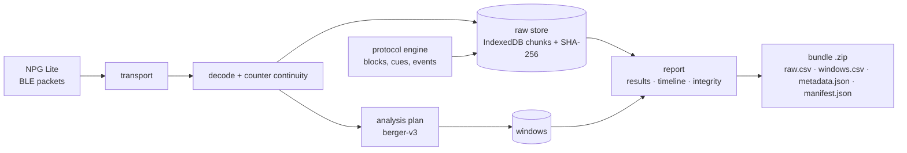

# Thermodrift Lab

Browser instruments for self-run EEG experiments with an [Upside Down Labs NPG Lite](https://docs.upsidedownlabs.tech/hardware/bioamp/neuro-play-ground-lite/index.html). Plain HTML and JavaScript modules, no build step, no server-side code. Raw samples stay in your browser until you export them.

The first instrument is **Berger Lab**: the eyes-open / eyes-closed alpha test (Hans Berger, 1929). It checks that a homemade setup can measure something real before you trust it with anything subtler.



## Quick start

Hosted: <https://app.thermodrift.com/berger/> (desktop Chrome or Edge). Sessions stay in your browser.

To run it locally — requirements: Node.js 22.6 or newer (only for the local server and tests) and desktop Chrome or Edge (Web Bluetooth).

```sh
npm run serve        # http://127.0.0.1:8072/apps/
npm test             # unit and flow tests (synthetic data only)
npm run check        # tokens up to date + tests + privacy scan
```

Open `http://127.0.0.1:8072/apps/berger/?source=simulated` to try the full flow without hardware. The simulator sends a fixed, labelled test pattern in the real packet format; it does not react to the protocol, so it can never show a Berger effect.

With a board: open `http://127.0.0.1:8072/apps/berger/`, connect, complete the setup checks, start acquisition, test the spoken cue, then run the long Berger test. Use `127.0.0.1`, not a LAN address: Web Bluetooth needs a secure context.

## What is in the box

| Path | What it is |
|---|---|
| `apps/berger/` | Berger Lab 3.2: live acquisition, protocols, paired results |
| `apps/report/` | Reopens a saved session, an exported bundle or a Berger Lab v3 file set. Never touches hardware |
| `apps/catalog/` | Design catalogue: tokens, components, states, chart grammar |
| `src/core/` | Packet decoding, counters, filters, FFT/Welch, quality flags |
| `src/analysis/` | Analysis plans (`berger-v3`) and the adherence rule |
| `src/protocol/` | Protocol engine, Berger protocol definitions, speech cues |
| `src/session/` | Recorder, IndexedDB store, bundle export, loaders |
| `src/lab/` | Controller shared by every acquisition app, view-model, session locks |
| `src/transport/` | NPG Lite over Web Bluetooth, simulated test pattern |
| `src/design/` | Design tokens (JSON → CSS, JS, Tailwind preset) and instrument CSS |
| `tools/` | Local server, token builder, privacy scan, v3 replay |
| `docs/` | Architecture, DSP contract, hardware matrix, formats, guides, decisions |

## Measurement contract (short)

- Units are **ADC counts** (12-bit). Nothing is converted to microvolts: the gain is not calibrated.
- The primary metric is the median absolute 8–13 Hz Welch power per block after a fixed causal 0.5–45 Hz filter and 50/100/150/200 Hz notches, then closed / open within each prompted pair. Details: [`docs/DSP_CONTRACT.md`](docs/DSP_CONTRACT.md).
- Eye states are **prompted**, not measured. Adherence is a separate annotation layer; raw rows never change.
- An FFT magnitude is never labelled a power spectral density.
- Results are descriptive for one session; there are no p-values.

## Status

`0.1.0` (unreleased). Berger Lab has been used on one person with one NPG Lite. The analysis core reproduces the original app's saved windows on that recording; that is a numerical check, not a validation of EEG hardware. See [`SAFETY_AND_LIMITATIONS.md`](SAFETY_AND_LIMITATIONS.md) and [`docs/HARDWARE.md`](docs/HARDWARE.md).

## Contributing and licence

See [`CONTRIBUTING.md`](CONTRIBUTING.md). Code: MIT ([`LICENSE`](LICENSE); inventory in [`LICENSING.md`](LICENSING.md)). The Thermodrift name and logo are not covered by the code licence ([`brand/NOTICE.md`](brand/NOTICE.md)).
