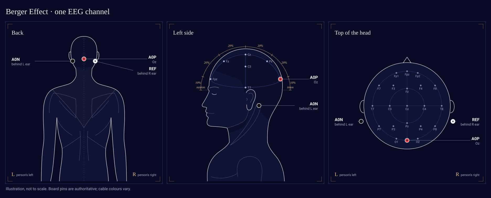
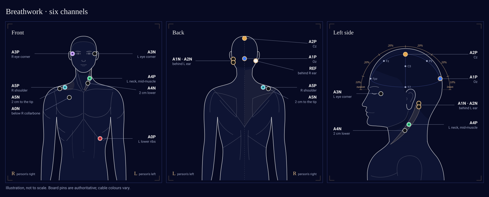
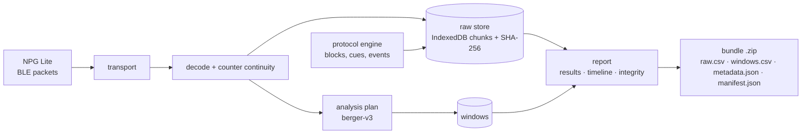

# Thermodrift Lab

Browser instruments for self-run biosignal experiments with an [Upside Down Labs NPG Lite](https://docs.upsidedownlabs.tech/hardware/bioamp/neuro-play-ground-lite/index.html). Plain HTML and JavaScript modules, no build step, no server-side code. Raw samples stay in your browser until you export them.

| Instrument | Question | Channels | Open |
|---|---|---|---|
| **Berger Effect** | Does closing the eyes raise 8–13 Hz power at the back of the head? The 1929 test, and a first check of the recording chain. | 1 EEG | [With a board](https://app.thermodrift.com/berger/) · [Simulator](https://app.thermodrift.com/berger/?source=simulated) |
| **Breathwork** | What do heart, brain, eye and muscle signals do around a guided breathing session, and which of them can be read during it? | Up to 6: ECG, EEG, EOG, EMG | [With a board](https://app.thermodrift.com/breathwork/) · [Simulator](https://app.thermodrift.com/breathwork/?source=simulated) |

Both have four tabs: **Setup** (where the electrodes go), **Signal** (live trace and spectrum), **Protocol** (the session step by step, and the timed runs) and **Results**. Breathwork adds **Recordings**: each recording with its own export and test flag. Its Protocol tab offers two session formats, Wim Hof-style and Holotropic-style, and the export records the choice. A **Run** panel stays beside Signal and Protocol, with the current block, the protocol launchers and markers. Results can show labelled example results before your first run.

## Where the electrodes go

The apps draw these figures from their montage definitions, for every montage.

**Berger Effect**, one EEG channel:



**Breathwork**, six channels:



## How it works



## Quick start

Hosted: <https://app.thermodrift.com/> (desktop Chrome or Edge). Sessions stay in your browser.

To run it locally — requirements: Node.js 22.6 or newer (only for the local server and tests) and desktop Chrome or Edge (Web Bluetooth).

```sh
npm run serve        # http://127.0.0.1:8072/apps/
npm test             # unit and flow tests (synthetic data only)
npm run check        # tokens and figures up to date + tests + privacy scan
```

Open `http://127.0.0.1:8072/apps/berger/?source=simulated` or `.../apps/breathwork/?source=simulated` to try the full flow without hardware. The simulator sends a fixed, labelled test pattern in the real packet format; it does not react to the protocol, so it can never show a Berger effect.

With a board: open the app without `?source=simulated`, connect, complete the setup checks, start acquisition, test the spoken cue, then follow the **Protocol** tab. Use `127.0.0.1`, not a LAN address: Web Bluetooth needs a secure context.

## What is in the box

| Path | What it is |
|---|---|
| `apps/berger/` | Berger Effect 3.3: live acquisition, protocols, paired results |
| `apps/breathwork/` | Breathwork 0.2: up to six channels, signal check, identical rests around a guided session, one export per recording |
| `apps/report/` | Reopens a saved session, an exported bundle or a Berger v3 file set. Never touches hardware |
| `apps/catalog/` | Design catalogue: tokens, components, states, chart grammar |
| `src/core/` | Packet decoding, counters, filters, FFT/Welch, quality flags |
| `src/analysis/` | Analysis plan `berger-v3` (the Breathwork app's `breathwork-1` reuses its window engine) and the adherence rule |
| `src/protocol/` | Protocol engine, Berger and breathwork protocol definitions, speech cues |
| `src/session/` | Recorder, IndexedDB store, bundle export, loaders |
| `src/lab/` | Controller shared by every acquisition app, view-model, session locks |
| `src/transport/` | NPG Lite over Web Bluetooth, simulated test pattern |
| `src/design/` | Design tokens (JSON → CSS, JS, Tailwind preset) and instrument CSS |
| `src/ui/` | Charts, tabs, electrode placement figures, written protocol view |
| `tools/` | Local server, token and figure builders, privacy scan, v3 replay |
| `docs/` | [Architecture](docs/ARCHITECTURE.md), [DSP contract](docs/DSP_CONTRACT.md), [hardware matrix](docs/HARDWARE.md), [session format](docs/SESSION_FORMAT.md), [protocols](docs/PROTOCOLS.md), [sources](docs/SOURCES.md), [troubleshooting](docs/TROUBLESHOOTING.md), guides, decisions |

## Measurement contract (short)

- Units are **ADC counts** (12-bit). Nothing is converted to microvolts: the gain is not calibrated.
- The primary metric is the median absolute 8–13 Hz Welch power per block after a fixed causal 0.5–45 Hz filter and 50/100/150/200 Hz notches, then closed / open within each prompted pair. Details: [`docs/DSP_CONTRACT.md`](docs/DSP_CONTRACT.md).
- Eye states are **prompted**, not measured. Adherence is a separate annotation layer; raw rows never change.
- An FFT magnitude is never labelled a power spectral density.
- Results are descriptive for one session; there are no p-values.
- The Breathwork app summarises the EEG channel live per block and exports all channels raw. Heart rate, breathing and muscle activity are analysed after export. Scalp EEG above about 20 Hz carries muscle activity, more so during effortful breathing.

## Hardware

An [NPG Lite](https://docs.upsidedownlabs.tech/hardware/bioamp/neuro-play-ground-lite/index.html) over Web Bluetooth, in desktop Chrome or Edge. Six channels need the VibZ+ playmate of the Beast kit. Gain and electrode impedance are not measured, and the inspected firmware can drop samples before numbering them. Vendor facts, code findings and unknowns are kept apart in [`docs/HARDWARE.md`](docs/HARDWARE.md). Not affiliated with Upside Down Labs.

## Safety and data

Not a medical device. The apps record: they send `START` and `STOP` to the board and never change its firmware. The Breathwork app cues its short signal check and supervises nothing. Fast breathing can cause fainting, so stay lying down, never in or near water. Read [`SAFETY_AND_LIMITATIONS.md`](SAFETY_AND_LIMITATIONS.md) first.

Recordings are stored in your browser (IndexedDB) and leave it only when you export them. The apps upload nothing and load no trackers.

## Status

`0.2.0`. Tested with one NPG Lite. Analysis plans are frozen: any change gets a new plan id.

## Contributing and licence

See [`CONTRIBUTING.md`](CONTRIBUTING.md). Code: MIT ([`LICENSE`](LICENSE); inventory in [`LICENSING.md`](LICENSING.md)). The Thermodrift name and logo are not covered by the code licence ([`brand/NOTICE.md`](brand/NOTICE.md)).
