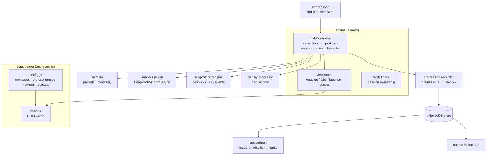

# Architecture

Static ES modules served from `127.0.0.1`, no bundler, no framework. Every instrument is a thin app (`apps/<name>/`) composed from shared layers in `src/`.

## Lifecycles

Four independent state machines, all visible in the UI:

| Lifecycle | States | Notes |
|---|---|---|
| Connection | unsupported · disconnected · connecting · connected · permission_denied · error | Owned by the transport |
| Acquisition | idle · starting · acquiring · stopping | A restart opens a new **segment** in the same session; all filter state is discarded |
| Protocol | idle · running · completed · interrupted · aborted | Never paused: stopping, disconnecting, a stalled stream or a failed cue **interrupts** it |
| Session | none · recording · closed · interrupted | Created at the first acquisition; setup locks then |

## Data path per BLE notification

1. `decodePacket` → records `{counter, channels[]}` (7/13/70/130-byte layouts).
2. `CounterTracker` → contiguous, gap (inferred missing count) or duplicate. Any discontinuity resets analysis and display state (v3 `clearRings`).
3. The recorder appends the raw row (index, arrival time, counter, channels, prompted phase, protocol and block ids). It flushes a chunk about every second.
4. Valid rows feed the analysis engine and the display processor separately.
5. Once per ≥500 ms the engine computes the latest window metrics and, every 2048 new samples, emits analysis windows that the recorder stores.

## App contract

An acquisition app provides, through `LabController`'s constructor:

| Dependency | Example (Berger) |
|---|---|
| `app` id, version, analysis plan id | `berger-lab`, `3.2.0`, `berger-v3-filtered-primary` |
| `transport` | `createNpgBleTransport()` or `createSimulatedTransport()` |
| `store` | `openIdbStore()` (fallback `MemoryStore`, labelled) |
| `analysis.createEngine(montage)` | `new BergerV3WindowEngine({ mode })` |
| `cues()` | `createSpeechCues()` / `createSilentCues()` |
| `describe(ctx)` | `describeBergerSession` → export metadata |
| `channelLabel(montage, ch)` | montage channel names |
| `createDisplay()` (optional) | display processor for the live view |

The report never imports a transport. See [`NEW_APP_GUIDE.md`](NEW_APP_GUIDE.md) for a worked outline.

## Decisions

- [0001 — Browser persistence](decisions/0001-browser-persistence.md)
- [0002 — Analysis plan v3 is frozen](decisions/0002-analysis-plan-v3-frozen.md)
- [0003 — No build step](decisions/0003-no-build-step.md)
